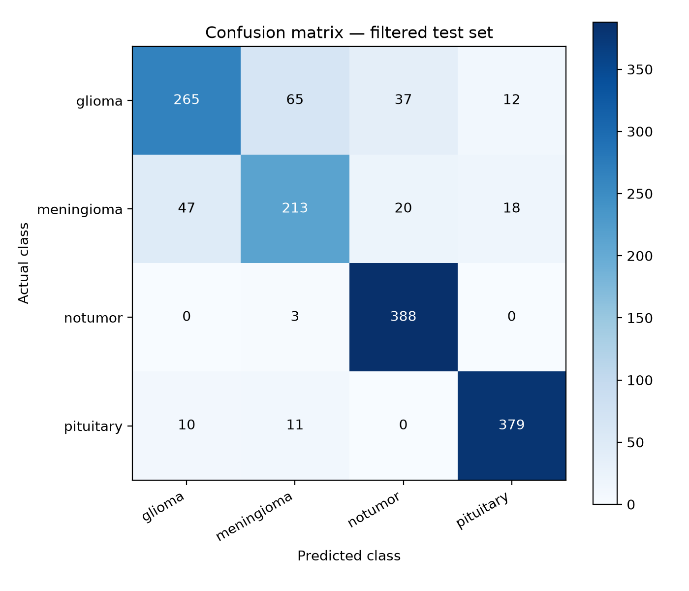
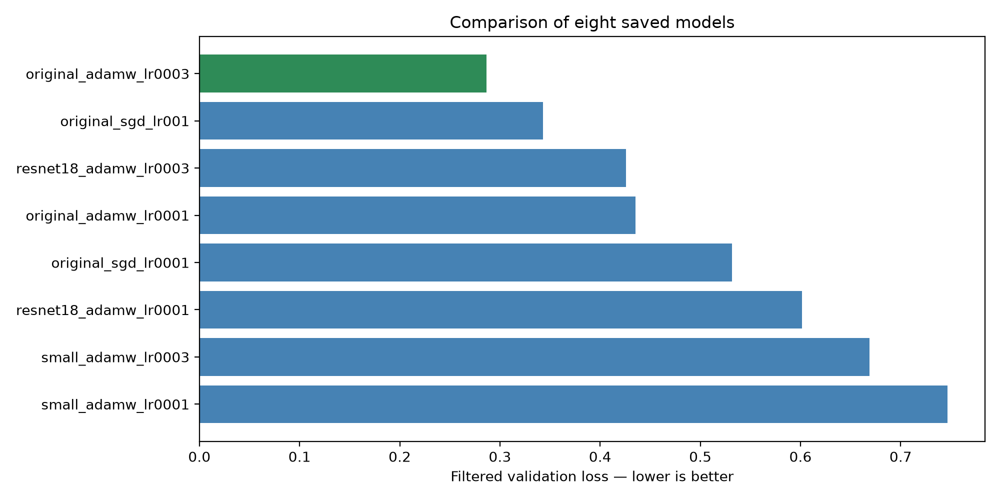
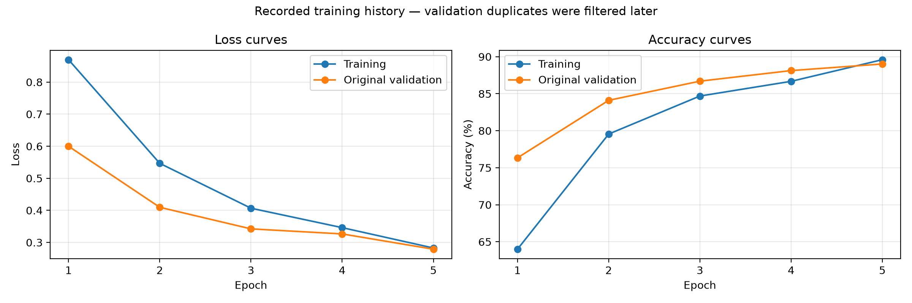

# Brain Tumor Classifier

Four-class brain MRI classification using Python and PyTorch.
Classes: glioma, meningioma, no tumour, and pituitary tumour.

## Experiments
- Eight configurations trained for five epochs each.
- Original CNN, smaller CNN, and frozen pretrained ResNet18.
- AdamW and SGD comparisons with different learning rates.
- Dropout, weight decay, learning-rate scheduling, and checkpoints.

## Results
- Selected experiment: original_adamw_lr0003
- Filtered validation accuracy: 88.63%.
- Filtered test images: 1468
- Filtered test accuracy: 84.81%.
- Macro F1: 0.836.

## Run a prediction
Install dependencies:

    python -m pip install -r requirements.txt

Run prediction:

    python predict_brain_tumor.py "path/to/image.jpg"

Model location: exported_model/brain_tumor_model.pth
Softmax scores are not calibrated clinical probabilities.
Development Python version: 3.14.6
Model reload and separate-process prediction checks passed.

## Evaluation limitations
Exact duplicates were discovered AFTER training.
Shared exact-image groups: training/validation 47,
training/testing 85, validation/testing 26.
These pairwise counts are not additive unique-image counts.
Evaluation subsets were filtered to exclude exact overlap,
and repeated images within those subsets were reduced to one copy.
Original validation data already influenced checkpoint selection
and learning-rate scheduling. Training curves show that history.
Patient overlap and near-duplicates have not been ruled out.
Results are exploratory, not a fully leakage-free benchmark.

## Notebook
notebooks/experiment_log.ipynb is a historical development log.
It contains setup, training, recovery, and evaluation cells.
It is not a clean Run All pipeline. Use the script for inference.

## Credits
Initial tutorial: https://www.youtube.com/watch?v=mGJ6OZmR-Xk
Extended with architecture comparisons, tuning, checkpointing,
duplicate auditing, evaluation reports, and standalone inference.
Exact dataset source and license still require verification.
Dataset images and full training checkpoints are not included.

## Intended use
Educational research only. Not for clinical diagnosis.
